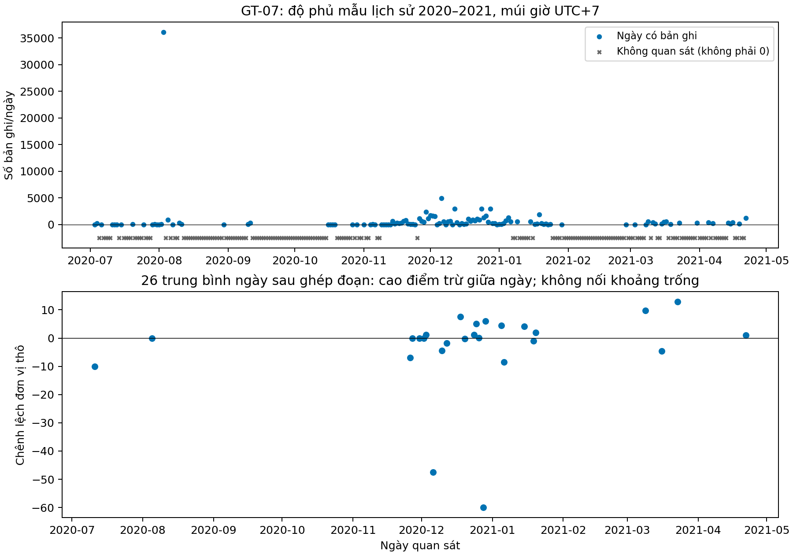

# Thẩm định thống kê và độ phủ thời gian

[KẾT QUẢ ĐO] GT-07 có 90,938 bản ghi, 120/294 ngày lịch được quan sát; 174 ngày không quan sát được giữ là missing. Một ngày chứa 39.69% bản ghi. Sau ghép cửa sổ cùng đoạn–ngày còn 404 cặp trên 26 ngày, 302 đoạn; 8 ngày chỉ có một cặp.

Định nghĩa giữ nguyên: cao điểm 07:00–08:59 và 16:00–17:59; giữa ngày 10:00–14:59, UTC+7. Lấy trung vị từng cửa sổ trong đoạn–ngày, rồi trừ. Chưa xác minh đơn vị velocity, không viết km/h. Các bản ghi ngoài hai cửa sổ không thuộc tương phản; cặp thiếu một cửa sổ bị loại và không tự bù.

| Cách tổng hợp | Ước lượng, đơn vị thô | Đơn vị được cân đều |
| --- | ---: | --- |
| Trung bình các trung bình ngày | -3.459 | 26 ngày |
| Trung bình tất cả cặp đoạn–ngày | -0.020 | 404 cặp |
| Trung vị các trung bình ngày | 0.000 | 26 ngày |
| Trung bình ngày có ít nhất 2 cặp | 1.448 | 18 ngày |
| Trung bình ngày có ít nhất 5 cặp | 0.575 | 13 ngày |

[DIỄN GIẢI] Đây là các đại lượng đích khác nhau. Khác số không chứng minh đại lượng nào là “đúng” cho thành phố; nó cho thấy kết luận phụ thuộc mạnh vào đối tượng được cân. Hai phân tích lọc ngày là độ nhạy hậu nghiệm, không là quy tắc loại dữ liệu đã đăng ký trước. Giữ mọi ngày và mọi kết quả; không chọn biến thể thuận dấu hoặc thuận p.

Tái lập được t(25)=-1.117, p=0.274778; bootstrap iid 5.000 lần, seed 42, khoảng phân vị 95% [-10.072, 1.791]. Trung bình ngày/SD ngày=-0.219; đây là chuẩn hóa nội bộ, không đánh giá ý nghĩa thực tế khi chưa có đơn vị. Loại lần lượt một ngày cho ước lượng [-4.111, -1.198], là khoảng độ nhạy, không phải CI.

Chẩn đoán Shapiro trên 26 chênh lệch ngày: W=0.629, p=6.45e-07. Kết quả này không kiểm tra tính độc lập hoặc đại diện. Không tự chuyển sang Wilcoxon vì đổi câu hỏi và vẫn có giả định. Tính độc lập ngày chưa được thiết kế/kiểm chứng; đường lặp và ngày rời rạc còn tồn tại. Vì vậy **p/CI iid không được dùng để suy luận dân số hay khẳng định “không có chênh lệch”**. Không thêm kiểm định để tìm ý nghĩa thống kê, không áp dụng CI theo từng dòng trong 90.938 dòng.

## Điều kiện áp dụng chuỗi thời gian

- GT-01 chỉ có 3 điểm năm; GT-02 có 3 điểm tháng sơ bộ và sai khác số tháng trước suy ngược từ bản tin sau. Không đủ mùa vụ/baseline; không chạy ADF, STL hoặc ARIMA.
- GT-07 có 294 ngày lịch nhưng 174 ngày không quan sát, mức phủ đoạn và cơ chế lấy mẫu không ổn định. Số ngày trải dài không tự tạo chuỗi đều có thể so sánh. Không nội suy hoặc coi missing là không có xe/ùn.
- GT-10/11 là kiểm kê nguy cơ, không là chuỗi sự kiện; lịch kế hoạch không là ngày tai nạn.
- GT-12 calendar năm 2018: kiểm lại ba feed đều không có orphan trip/stop và không có trùng trip–sequence. Headway lịch trình theo route chưa được kiểm điều kiện direction/service-day; không dùng làm thời gian chờ xe buýt hiện tại.

Đã áp dụng bước kiểm tra điều kiện của skill time-series-analysis. Chưa thỏa đầu vào để chạy phân rã/dự báo; đây là quyết định phương pháp có ghi nhận, không là kết quả dự báo thất bại. Chưa có nhu cầu chọn chân trời dự báo hoặc số liệu đủ để đánh giá holdout.

## Phân rã biến động và giới hạn nguyên nhân

`tables/province_signed_contributions.csv` dùng drill_down trên 63 tỉnh, tách riêng từng chỉ số; tuyệt đối không cộng tổng vùng lồng nhau. Mẫu số contribution là thay đổi ròng tổng 63 tỉnh, không gồm Khác. Đóng góp âm hoặc trên 100% có thể xuất hiện do bù trừ; không là thị phần nguy cơ. Không quy tỉnh có contribution lớn thành nguyên nhân hay điểm can thiệp.

Skill root-cause-investigation cần baseline trước thay đổi và nhật ký sự kiện. Chưa có ít nhất 30 ngày trước biến động; không chạy z-score để gọi “bình thường”, không quy thay đổi cho camera, pháp luật, giáo dục hoặc hạ tầng. Các khả năng đổi ghi nhận, exposure, cơ cấu phương tiện và thay đổi thực tế đều còn mở.

Mô tả hình: dấu tròn là ngày có bản ghi; dấu x dưới mốc 0 là ngày không quan sát, không phải giá trị âm của số bản ghi. Panel dưới hiện cả 26 trung bình ngày, không nối qua khoảng trống. Bảng dữ liệu kèm theo và `figure_manifest.json` ghi phiên bản, kích thước, DPI và phạm vi. Chưa chứng nhận tiêu chuẩn tạp chí/accessibility.
